# Project chart gallery

[Return to portfolio](README.md)

Original saved chart outputs; see the README for interpretation and measurement limits.

## 1. Annual complaints

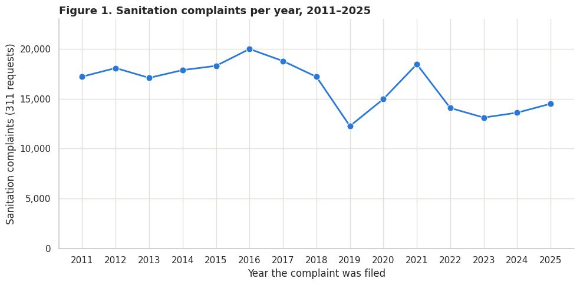

## 2. Complaints by ZIP

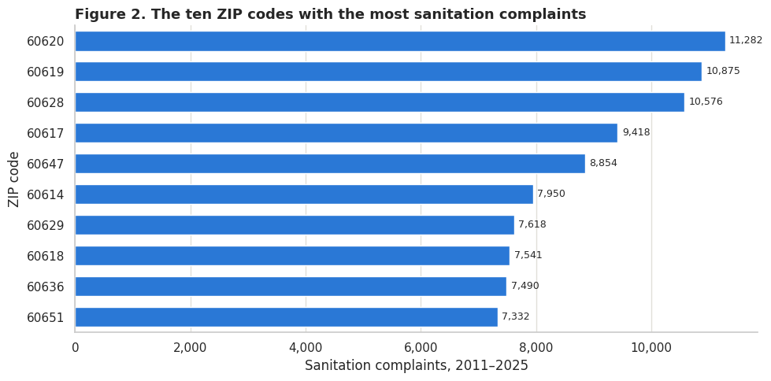

## 3. Complaint density

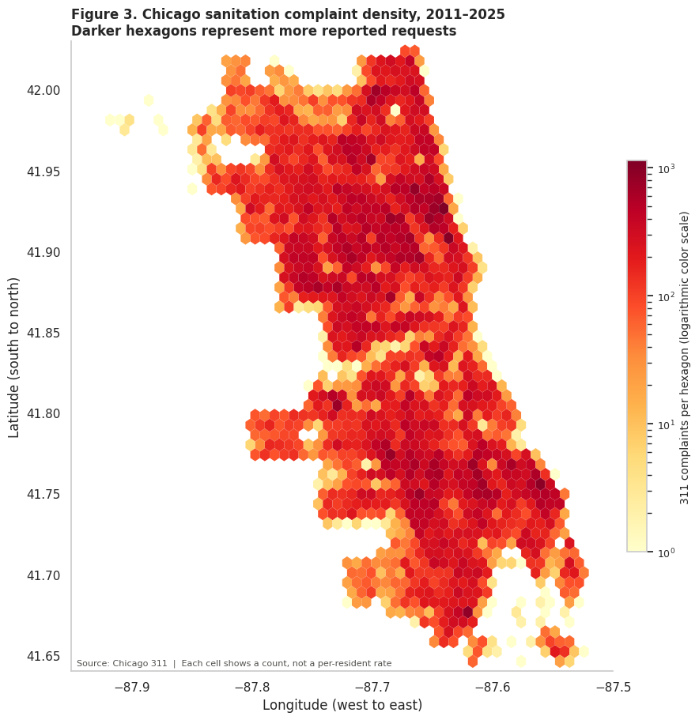

## 4. Annual inspection failure

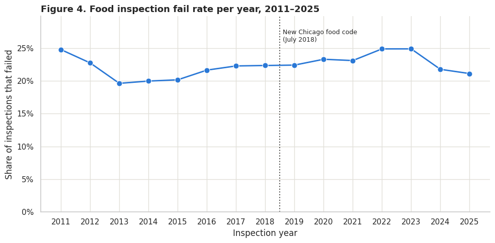

## 5. Failures by risk

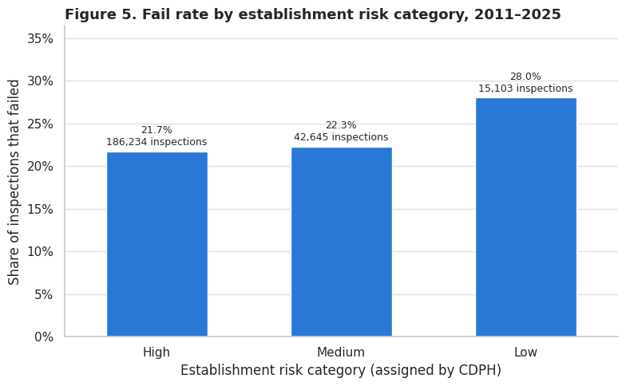

## 6. ZIP complaint and failure association

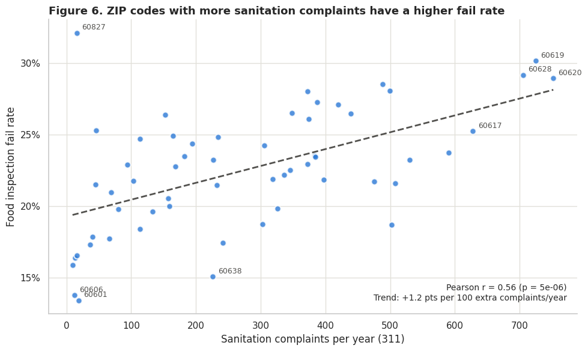

## 7. Complaint quartiles

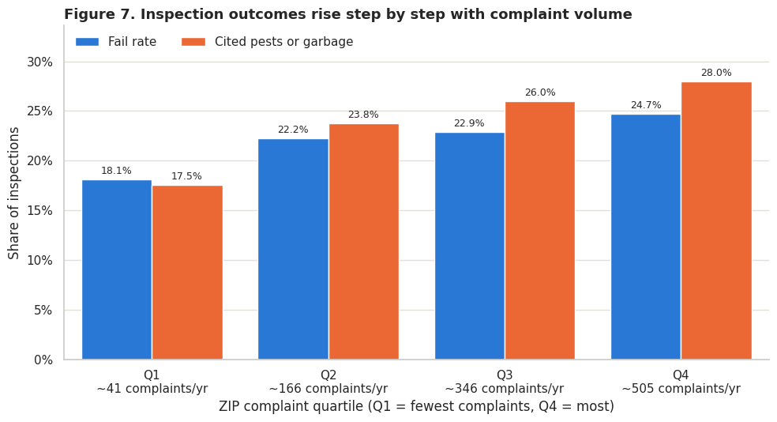

## 8. ZIP screening groups

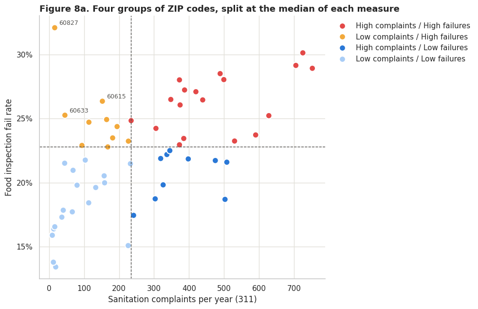

## 9. ZIP screening map

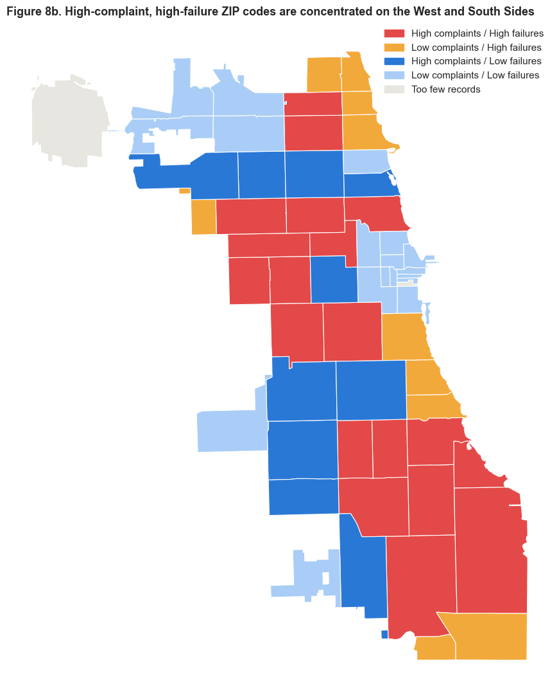

## 10. Pest and garbage keyword association

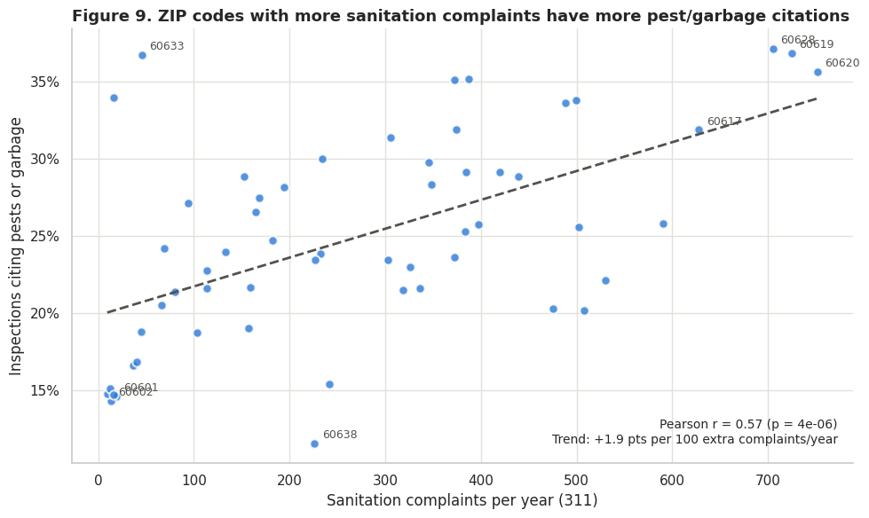

## 11. Violation code differences

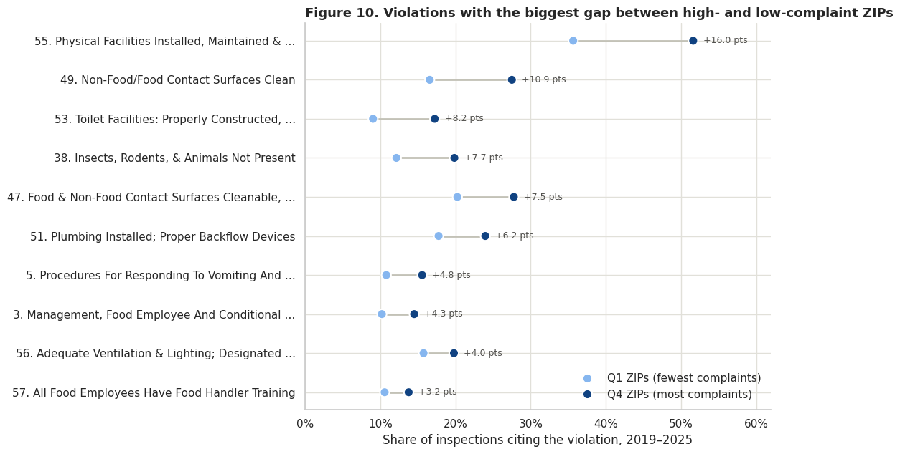

## 12. Risk category comparisons

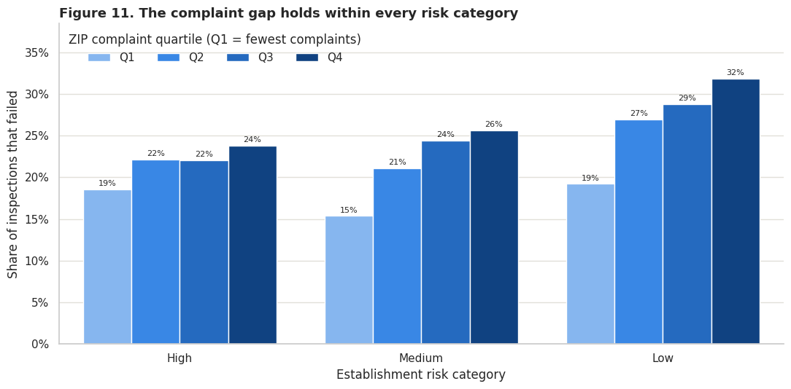

## 13. Inspection purpose comparisons

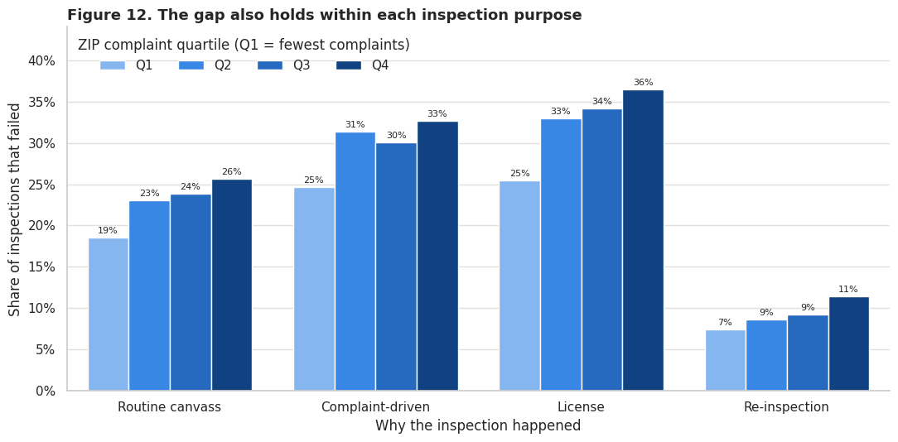

## 14. Annual correlations

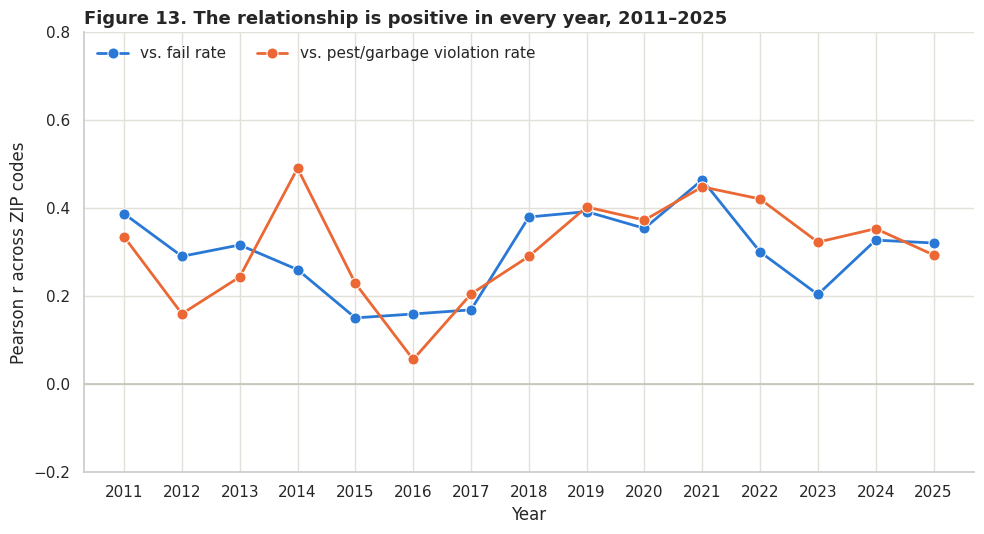

## 15. Exploratory within ZIP comparison

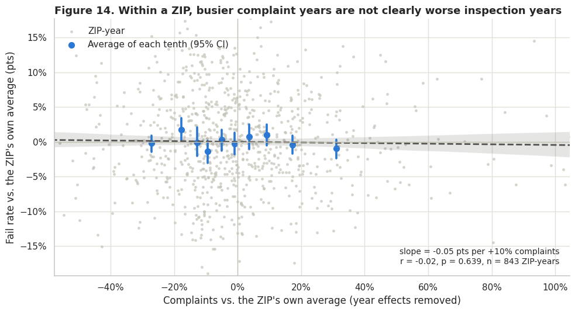

## 16. Illustrative ZIP shortlist

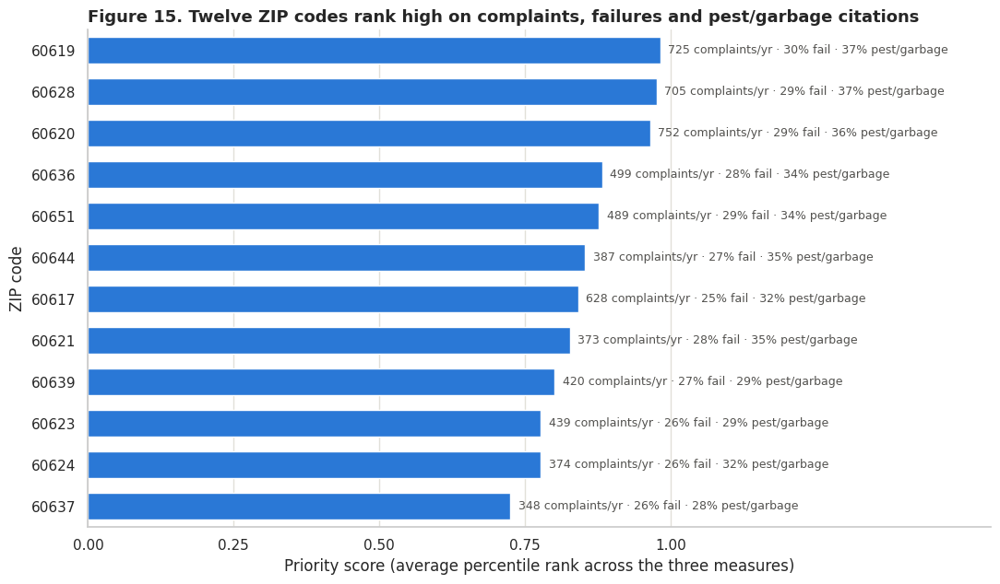