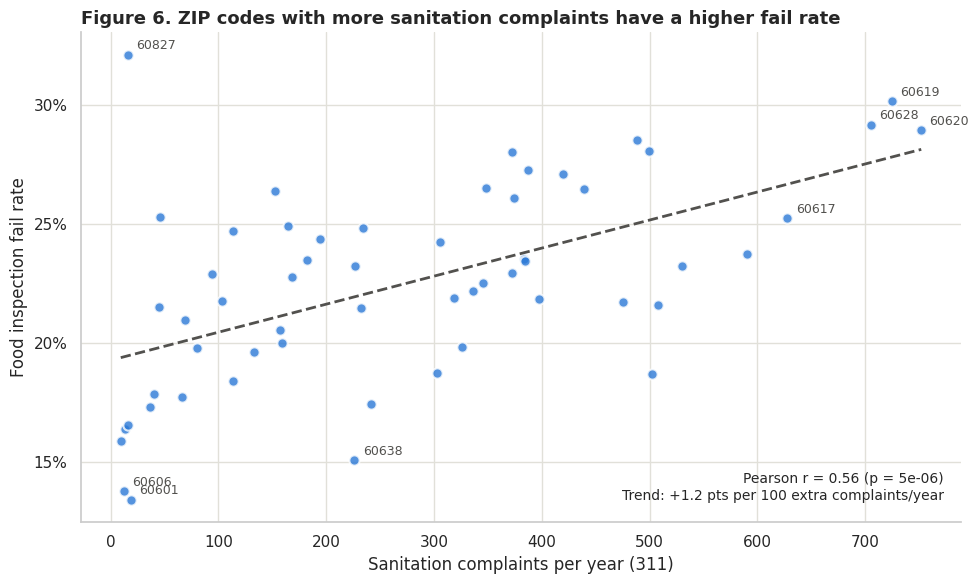
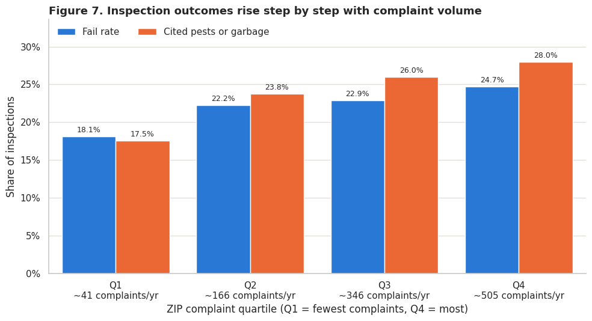
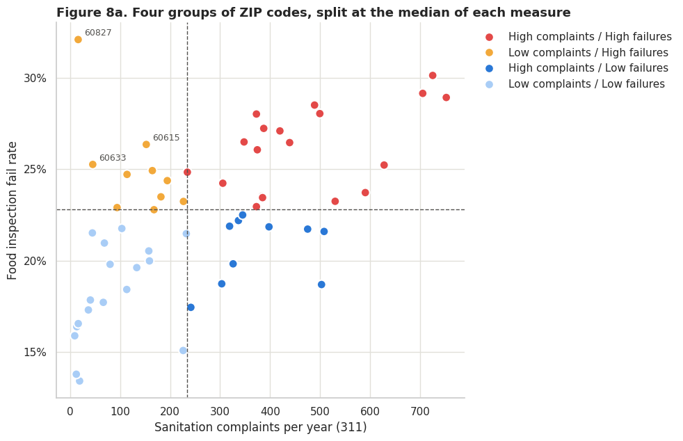
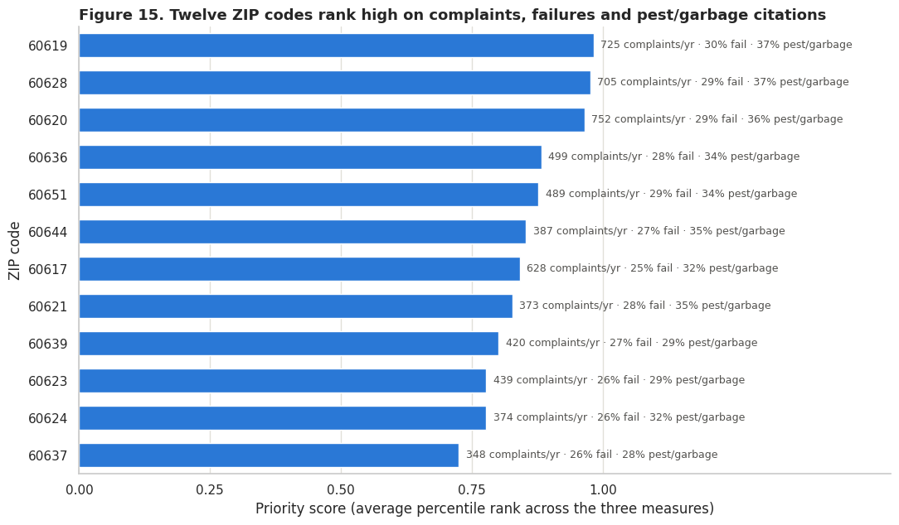

# Chicago sanitation complaints and food inspections

**Can public 311 reports help Chicago decide where to investigate food-safety conditions?**

An MSBA team project analyzing Chicago sanitation complaints and food inspections from **2011–2025**. Prepared from the BA780 Cohort B Team 03 final project and adapted into a visual portfolio for ES621.

## Project at a glance

| Scope | Supplied notebook results |
|---|---|
| Scored inspections | 244,005, including Pass, Pass w/ Conditions and Fail |
| Cleaned sanitation requests | 245,373 |
| ZIP codes in the main comparison | 57 |
| ZIP coverage | 97.9% of cleaned inspections; 95.3% of cleaned complaints |
| Tools | Python, pandas, NumPy, Matplotlib, seaborn, SciPy and GeoPandas |

**Main finding:** ZIP codes with more sanitation complaints tended to have higher food-inspection failure rates. This is a geographic association; it does not establish causation or validate a prediction system.

[Explore the companion notebook](Chicago-Sanitation-Analysis.ipynb) · [View all 16 charts](CHARTS.md)

## The business question

Chicago’s Department of Public Health has limited inspection and prevention resources. We asked whether sanitation complaints provide a useful additional geographic signal for reviewing inspection coverage and planning coordinated sanitation outreach.

The decision is whether to **test the indicator in a pilot**. The analysis does not justify automatic staffing changes or labeling individual restaurants as unsafe.

## What the data shows

### 1. More complaints are associated with higher failure rates across ZIP codes



The ZIP-level Pearson correlation is **0.56**. The descriptive trend corresponds to about **1.2 percentage points** higher failure per additional 100 complaints a year. These are raw complaint counts, without population or business-count normalization.

### 2. The pattern is visible across complaint quartiles



| Outcome | Lowest complaint quartile | Highest complaint quartile | Difference |
|---|---:|---:|---:|
| Inspection failure rate | 18.1% | 24.7% | +6.6 percentage points |
| Pest/garbage keyword flag rate | 17.5% | 28.0% | +10.5 percentage points |

Quartiles group ZIP codes by complaint volume. The displayed outcome rates pool inspection visits within each group; they are not equally weighted averages of ZIP rates. The keyword flag searches violation descriptions and comments and may include negated mentions or standard requirements. It is a proxy that needs validation.

### 3. Complaint volume alone misses some high-failure areas



**Ten ZIP codes have below-median complaints and at-or-above-median failure rates.** A complaint-only rule could overlook them. Maintain baseline inspection coverage and investigate reporting access before using complaints to prioritize neighborhoods.

### 4. A shortlist can guide review, with safeguards



The illustrative twelve-ZIP shortlist accounts for **39% of complaints and 20% of inspections within the 57 analyzed ZIPs**. Its inspection failure rate is **27.6%**, compared with **22.4%** across the analyzed ZIPs. Those shares do not establish underinspection: facility counts and inspection needs differ.

## How the analysis works

1. Load four food-inspection ZIP archives and one combined sanitation-request archive from the team repository.
2. Align shared fields and stack the two record types; do not link individual complaints to restaurants.
3. Remove repeated IDs and city-marked duplicate requests. Keep scored inspections and records dated 2011–2025.
4. Normalize ZIP fields and aggregate each dataset to ZIP code. Retain ZIPs with at least 200 inspections and 100 complaints.
5. Compare correlations, complaint quartiles, violation codes, risk categories, inspection purposes and annual patterns.
6. Rank ZIPs using the average percentile rank of complaint volume, failure rate and the pest/garbage keyword flag rate.

The original exact-address join matched few complaints and could duplicate inspections. ZIP-level aggregation avoids that counting problem but cannot connect a specific complaint to an establishment.

## Recommended next step

Test a small sanitation and routine-inspection pilot after reviewing licensed-establishment counts and existing schedules. Coordinate pest-proofing, building-cleanliness and waste-handling outreach. Compare follow-up outcomes with comparable areas, retain coverage in low-complaint/high-failure ZIPs, and track staffing cost and reporting fairness.

## Limits that matter

- **Association and selection:** Inspection visits are not random; ZIP characteristics and complaint-reporting behavior can affect both datasets. Repeated visits to the same business are counted as separate inspections.
- **Geographic scale:** ZIP patterns do not describe every resident or restaurant. Some ZIP codes extend beyond Chicago’s coverage.
- **Measurement:** Counts are not per-resident or per-business rates. Missing violation text is treated as no keyword flag; keyword mentions do not verify a pest finding. Code definitions changed in July 2018, so code comparisons use 2019–2025.
- **Inference:** Nominal correlation p-values do not adjust for spatial dependence or multiple exploratory comparisons.
- **Time:** The supplied within-ZIP calculation reports little annual association (nominal p approximately 0.64). Sequential demeaning on an unbalanced panel and unclustered inference make it exploratory, not a definitive fixed-effects test or proof that spikes have no value. Joint ZIP/year effects, appropriate clustered uncertainty and lagged validation are needed.
- **Ranking:** Equal weights and a twelve-ZIP cutoff are analyst choices. The ranking reuses observed outcomes and has no held-out predictive evaluation.

## Run the project

Use Python 3.10 or newer in a network-enabled environment:

```bash
python -m pip install -r requirements.txt
jupyter notebook Chicago-Sanitation-Analysis.ipynb
```

Run cells from top to bottom. The notebook downloads the five archives into `data/` and downloads city ZIP boundaries for its map. If network access is unavailable, place the five named archives and `chicago_zip_boundaries.geojson` in `data/` first. Archive names appear in the loading cell.

**Verification status:** This portfolio uses the supplied notebook’s saved chart outputs and numerical results. The adaptation checked Python syntax, saved-output errors, chart extraction and local asset links; it did not download the raw data or re-execute the analysis. Requirements specify compatible minimum versions, not a tested environment lock.

## Files

| File | Purpose |
|---|---|
| `README.md` | Portfolio overview and selected visual evidence |
| `Chicago-Sanitation-Analysis.ipynb` | Analysis, saved outputs and clarified limitations |
| `CHARTS.md` and `assets/` | All 16 original chart outputs |
| `requirements.txt` | Python dependencies |
| `Blackboard-Submission.docx` | Summary of portfolio updates; insert the published repository URL |
| `START-HERE.txt` | Upload and submission steps |

## Sources and attribution

- [Chicago Food Inspections](https://data.cityofchicago.org/Health-Human-Services/Food-Inspections/4ijn-s7e5)
- [Historical sanitation complaints](https://data.cityofchicago.org/Service-Requests/311-Service-Requests-Sanitation-Code-Complaints-Hi/me59-5fac)
- [Current 311 requests](https://data.cityofchicago.org/Service-Requests/311-Service-Requests/v6vf-nfxy)
- [Chicago ZIP boundaries](https://data.cityofchicago.org/d/unjd-c2ca)
- [Team data repository](https://github.com/idanm-commiting/Sanitation-Project)

Analysis and original figures: **BA780 Cohort B Team 03**. This portfolio presents a team project and does not claim sole authorship or assign unverified individual contributions. The companion notebook retains the original AI disclosure and adds disclosure of this ChatGPT-assisted adaptation. Review all work before submission.
